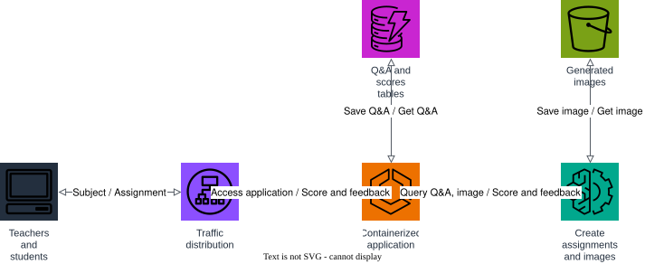

# AWS Project: Student Learning Assistant

Deploy a containerized application that uses generative AI foundation models to create, save, and present assignments on a given topic.

1. teachers and students reach the app through the traffic-distribution load balancer (Application Load Balancer);
2. the load balancer routes requests to the containerized application (ECS Fargate service);
3. the containerized application calls Amazon Bedrock foundation models to create assignment Q&A and illustrations;
4. Q&A pairs and scores are saved to DynamoDB, and generated images are saved to S3.

## Prerequisites

- Docker
- Terraform 1.5+
- AWS CLI

## Start Floci

```bash
docker compose up -d
```

## Apply Terraform

```bash
terraform init
terraform apply
```

## Architecture



The diagram source is a real, editable [draw.io](https://www.drawio.com/) file at [docs/architecture.drawio](docs/architecture.drawio), generated programmatically with the [drawpyo](https://github.com/MerrimanInd/drawpyo) Python library. Open the `.drawio` file directly on GitHub or with the draw.io desktop app / [app.diagrams.net](https://app.diagrams.net/) to edit it.

To regenerate the diagram (`.drawio` source + the `.svg`/`.png` embedded above) after changing the architecture:

```bash
python3 -m venv .diagram-venv
.diagram-venv/bin/pip install drawpyo
.diagram-venv/bin/python scripts/generate_diagram.py

# rasterize the .drawio file to svg/png (used by the README) via headless draw.io
docker run --rm -v "$PWD/docs":/data -w /data rlespinasse/drawio-export -f svg -o . --output-mode relative --remove-page-suffix .
docker run --rm -v "$PWD/docs":/data -w /data rlespinasse/drawio-export -f png -o . --output-mode relative --remove-page-suffix -t .
```

## The containerized application

The app lives in [app/](app) — a small Flask service, built as a Docker image and deployed to ECS Fargate behind the ALB. Build and run it locally:

```bash
cd app
docker build -t student-learning-assistant .
docker run --rm -p 8080:8080 \
  -e TABLE_NAME=floci-learning-assistant-qa-scores \
  -e BUCKET_NAME=floci-learning-assistant-generated-images \
  -e TEXT_MODEL_ID=amazon.titan-text-express-v1 \
  -e IMAGE_MODEL_ID=stability.stable-diffusion-xl-v1 \
  -e AWS_ENDPOINT_URL=http://host.docker.internal:4566 \
  student-learning-assistant
```

## Test the API

```bash
ALB_URL=$(terraform output -raw alb_dns_name)

# create an assignment (generates Q&A for a topic via Bedrock)
ASSIGNMENT_ID=$(curl -s -X POST "http://$ALB_URL/assignments" \
  -d '{"topic": "the water cycle"}' | jq -r '.assignment_id')

# fetch the saved assignment
curl -s "http://$ALB_URL/assignments/$ASSIGNMENT_ID" | jq

# generate and save an illustration for the assignment
curl -s -X POST "http://$ALB_URL/assignments/$ASSIGNMENT_ID/image" | jq

# save a score and feedback
curl -s -X POST "http://$ALB_URL/assignments/$ASSIGNMENT_ID/score" \
  -d '{"score": 90, "feedback": "Great work explaining evaporation."}' | jq
```

If you want to follow the execution, watch the Floci container logs:

```bash
docker compose logs -f floci
```

## Clean up

```bash
terraform destroy
docker compose down
```
